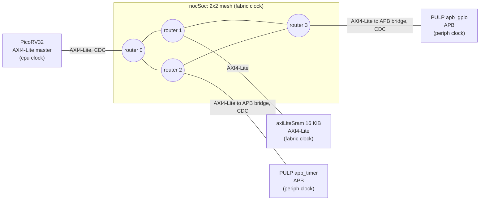

# example_networkOnChip_1

Demonstrates real-world use of the
[networkOnChip](https://github.com/tms4517/networkOnChip) project: a RISC-V
CPU boots from RAM over the NoC and its firmware reads and writes an APB timer
and an APB GPIO through the same mesh.

## The SoC



| Block | IP | Licence |
|---|---|---|
| CPU | [PicoRV32](https://github.com/YosysHQ/picorv32) `picorv32_axi`, RV32I | ISC |
| Timer | [pulp-platform/apb_timer](https://github.com/pulp-platform/apb_timer), 2 timers | Solderpad 0.51 |
| GPIO | [pulp-platform/apb_gpio](https://github.com/pulp-platform/apb_gpio), 32 pads | Solderpad 0.51 |
| NoC | [networkOnChip](https://github.com/tms4517/networkOnChip), generated by `nocGen.py` | see submodule |
| RAM | [rtl/axiLiteSram.sv](rtl/axiLiteSram.sv) (this repo) | |

The NoC is generated from [config/socNoc.json](config/socNoc.json). Because
the CPU speaks AXI4-Lite and the timer/GPIO speak APB, `nocGen.py` builds a
mixed-protocol NoC: requests carry a protocol opcode and the APB targets use
`apbTargetBridge` to convert AXI4-Lite to APB. Each endpoint whose clock
differs from the fabric clock gets a `cdcNiBridge`.

### Memory map

| Range | Target | Router |
|---|---|---|
| `0x0000_0000 - 0x0000_3FFF` | RAM (code, data, stack; console at `0x3FFC`) | 1 |
| `0x4000_0000 - 0x4000_0FFF` | Timer (timer *n* at `+0x10*n`: COUNT, CTRL, CMP) | 2 |
| `0x4000_1000 - 0x4000_1FFF` | GPIO (DIR, EN, IN, OUT, SET, CLR, INT*) | 3 |

Any other address gets a `DECERR` from the CPU's NI without entering the mesh.

## Boot and firmware

The PicoRV32 resets to address 0, so every instruction fetch travels through
the NoC to the RAM. The testbench preloads the RAM with the firmware image.
[firmware/main.c](firmware/main.c) then:

1. **RAM**: word, halfword and byte stores, checking that `WSTRB` crosses the NoC.
2. **GPIO**: sets enable/direction, writes OUT/SET/CLR and reads the pads back
   through a board-level loopback (pads 15:0 out to in).
3. **Timer**: loads a stopped counter, checks it counts once enabled, with and
   without the prescaler.
4. **Timer to GPIO**: timer 1's compare interrupt is wired to GPIO pad 16. The
   firmware enables a rising-edge interrupt on that pad, polls `INTSTATUS`
   until the timer event arrives, then checks clear-on-read.
5. **NoC error**: reads an unmapped address and checks the CPU keeps running.

Each check is printed on a console (byte stores to `0x3FFC`, printed by the
testbench). The result is driven on GPIO pad 31 (done) and pad 30 (pass).

## Running

```sh
git clone --recursive git@github.com:tms4517/example_networkOnChip_1.git
cd example_networkOnChip_1
make sim RISCV_PREFIX=<path>/riscv64-unknown-elf- CXX=<g++ >= 10>
```

| Target | Description |
|---|---|
| `make firmware` | Cross-compile `firmware/` to `build/firmware/firmware.hex` (+ `.lst`) |
| `make noc` | Generate the NoC into `generated/` from `config/socNoc.json` |
| `make lint` | Verilator `-Wall` on `socTop`, svlint on `rtl/` |
| `make sim` | Build and run the testbench; exits non-zero on failure |
| `make waves` | As `sim`, with `build/waves.fst` opened in gtkwave |
| `make clean` | Remove `build/` and `generated/` |

`SIM_ARGS=+traceRam` also logs every RAM access (instruction fetches included).

Requirements: a RISC-V GCC that accepts `-march=rv32i -mabi=ilp32` (no libc
or libgcc is linked), Verilator 5 with `--timing`, a C++20 compiler, svlint,
Python 3.

### Expected output (abridged)

```text
PicoRV32 booted over the networkOnChip mesh
RAM: word/halfword/byte stores (WSTRB through the NoC)
  [ OK ] word store = 0x11223344
  [ OK ] byte store lane 1 = 0x1122aa44
...
GPIO: direction, output set/clear and loopback input
[bus] 439876 ns WR GPIO  0x40001004 = 0x0001ffff
...
TIMER->GPIO: timer 1 compare pulse seen on GPIO pad 16
...
[bus] 1156492 ns RD GPIO  0x40001024 = 0x00010000 OKAY
  [ OK ] INTSTATUS pad 16 = 0x00010000
...
[bus] 1351932 ns RD NONE  0x80000000 = 0x00000000 DECERR
  [ OK ] CPU still running = 0x00000001
ALL TESTS PASSED
[tb] firmware done after 179416 CPU cycles (1435428 ns)
[tb]   CPU->RAM: 7000 reads (fetch+load), 75 writes
[tb]   CPU->timer/GPIO: 36 accesses
[tb] PASS
```

## Layout

```text
config/socNoc.json   NoC description fed to nocGen.py
rtl/                 socTop, axiLiteSram, file list, third-party lint waiver
firmware/            start.S, link.ld, soc.h, main.c, makehex.py
tb/tb_soc.sv         clocks, resets, board wiring, bus monitor, PASS/FAIL
networkOnChip/       submodule
third_party/         submodules: picorv32, apb_timer, apb_gpio (unmodified)
```
